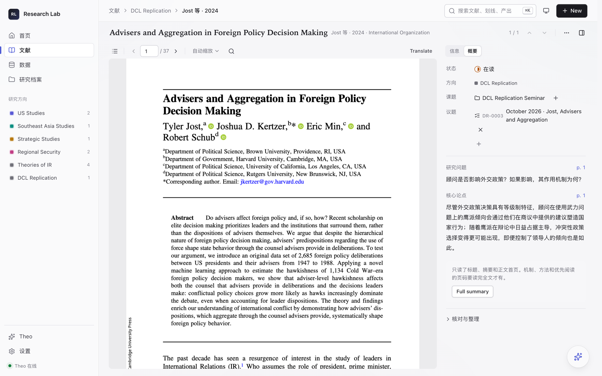
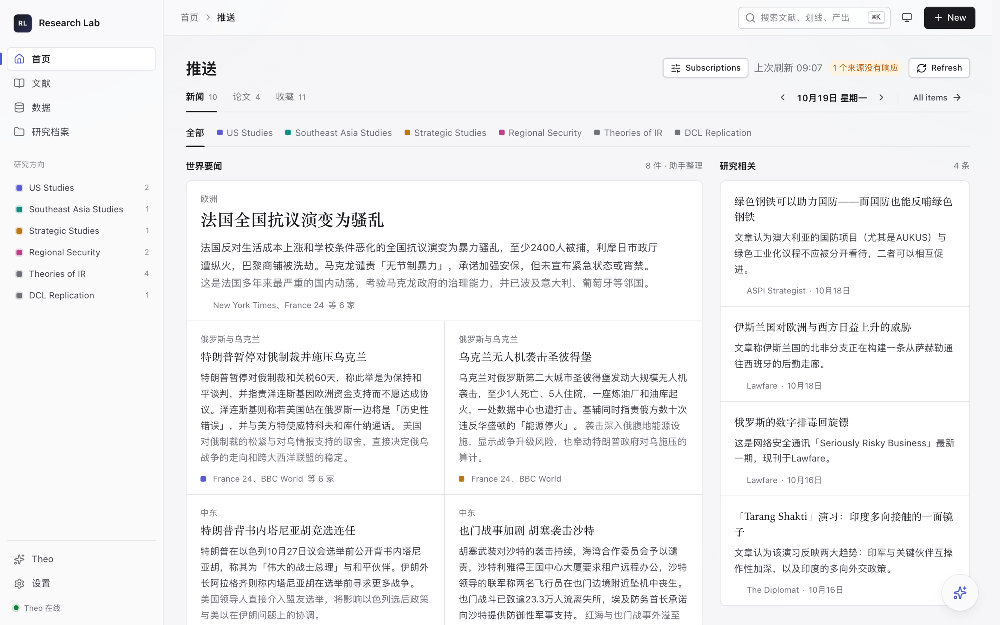
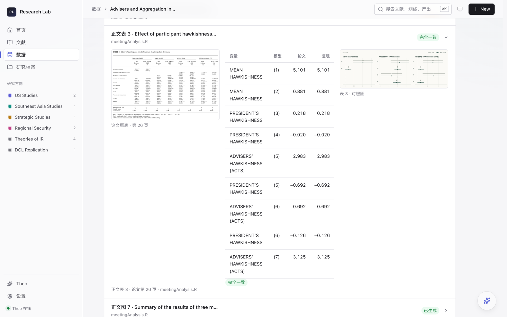
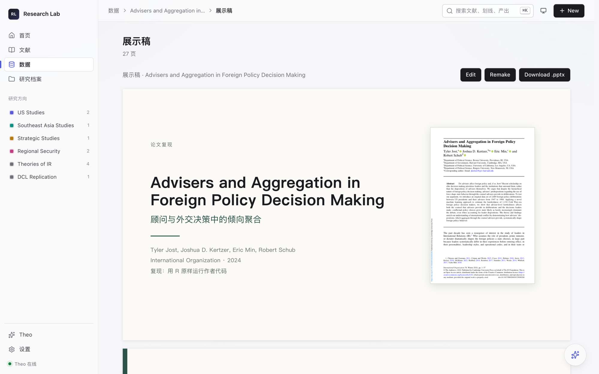

# Research Lab

A local research workspace for International Relations scholars: read papers, follow new journal articles, replicate published results, and turn a replication into a presentation. The interface is in Simplified Chinese.

给国际关系研究者的本地研究工作台。读论文、追新刊、复现论文、做汇报，在一个应用里完成；论文、笔记和数据都存在你自己的电脑上。



## 读论文

PDF 按原版排版显示，右栏是这篇论文的信息和中文概要。概要列出研究问题和核心论点，每一条都标着页码，点页码就跳到原文那一页。

信息栏里有整理好的引用，点 Copy 直接复制成期刊格式：

> Detlef Nolte, "How to Compare Regional Powers: Analytical Concepts and Research Topics", Review of International Studies, Vol. 36, No. 4, 2010, pp. 881-901.

点 DOI 会在浏览器里打开出版社页面。读的时候选中一段按 E 存成划线，写下自己的想法，之后在课题里按页码找回来。

## 每日推送



订阅你关心的期刊和新闻源。每天早上，新论文和新闻按研究方向排好，标题和摘要翻成中文；同一件事几家媒体的报道合成一条，并写清它为什么重要。周一会把周末的也补上。看到想读的论文，点标题就收进文献库，直接打开阅读器。

期刊文章来自 Crossref 和 OpenAlex，新闻来自各家的公开 RSS。订阅在设置的「学科与兴趣」里选，也可以自己添加期刊。

## 复现论文



从一篇论文出发，点一次 Run all，剩下的交给助手：取回作者的复现包，列出论文里的表和图，在沙箱里原样运行作者的 R 代码，再把每一个数和论文原表逐个对照。

页面上能看到研究问题、数据来源、用到的方法，以及每张表复现得怎么样。方法部分是教材式的讲解，比如双重差分为什么要做平行趋势检验。只有两类事会交给你：需要权限才能下载的数据，和需要你装的系统依赖。设置里的「复现环境」会检查 R 和编译工具缺什么，给出安装命令，还能一次预装常用的 R 包。

## 生成展示稿



复现跑完，展示稿也一起生成了。它按研究问题、理论、数据、方法、结果对照、结论组织，结果页把论文原表和复现结果放在一起。可以直接在应用里改文字，改好下载 .pptx。

## 还有

- **课题与议题**：研究方向、课题、带编号的议题和子议题。划线和产出都挂在课题下面，按 Command/Ctrl+K 搜论文、议题编号或 PDF 正文。
- **助手 Theo**：可以接 DeepSeek，也可以用本机的 Claude Code。概要、推送翻译、复现报告由它完成，它起草的研究产出要你采纳后才进研究档案。接上模型后，生成概要和翻译时会把需要的论文内容发给你选的服务；不接模型，也能读 PDF、整理文献和课题。

## 安装

需要 macOS、Python 3.12–3.14 和 [uv](https://docs.astral.sh/uv/)。在源码目录里：

```sh
uv sync --locked
RL_DISTRIBUTION=trial uv run rl init "$HOME/ResearchWorkspace"
RL_DISTRIBUTION=trial RL_REPO_ROOT="$HOME/ResearchWorkspace" RL_DATA_DIR="$HOME/ResearchWorkspace/app/data" RL_AUTOFIX=0 uv run rl serve
```

然后在浏览器打开 `http://127.0.0.1:4100`，首页的引导会带你建第一个课题、导入第一篇 PDF。工作区要选一个新的空目录，之后每次启动都带上同样的 RL_DISTRIBUTION、RL_REPO_ROOT 和 RL_DATA_DIR。

想要独立的 Mac 窗口，运行 `RL_DISTRIBUTION=trial uv run rl desktop`，在弹出的窗口里新建或选择工作区。

复现 R 代码需要 R。推荐装 [CRAN 官方的 macOS 版](https://cloud.r-project.org/bin/macosx/)，它能直接装编译好的 R 包；装完到「设置 → 复现环境」点 Preinstall。

## 开发

```sh
TZ=Asia/Shanghai uv run pytest -q app/tests
```

测试只用虚构的数据，不需要模型账号，也不会读你的工作区。参与开发请看 [CONTRIBUTING.md](CONTRIBUTING.md)，安全问题按 [SECURITY.md](SECURITY.md) 私下报告。

## 许可证

应用代码以 [AGPL-3.0-or-later](LICENSE) 发布，第三方组件保留各自的许可证，见 [THIRD-PARTY.md](THIRD-PARTY.md)。你的论文、笔记和工作区不在授权范围内。

截图中的论文：Tyler Jost, Joshua D. Kertzer, Eric Min and Robert Schub, "[Advisers and Aggregation in Foreign Policy Decision Making](https://doi.org/10.1017/S0020818323000280)", International Organization, Vol. 78, No. 1, 2024, pp. 1-37。© The Author(s), 2024，以 [CC BY 4.0](https://creativecommons.org/licenses/by/4.0/) 发布。
