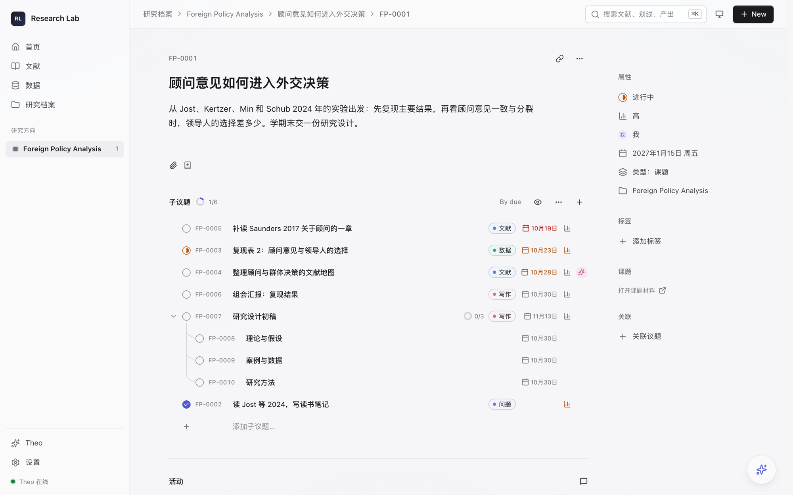
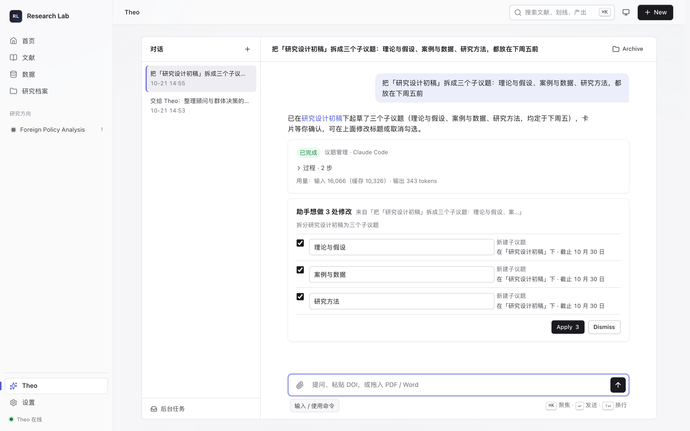

# Research Lab

A local research workspace for social scientists: read papers, follow new journal articles, replicate published results, manage research tasks, and work with an AI assistant. The interface is in Simplified Chinese.

给社会科学研究者的本地研究工作台：目前版本提供新闻及论文推送，文献阅读和摘要生成，方法复现和展示文稿，在 agent 支持下可在应用内管理研究进度，调整应用功能及视觉效果，所有数据保存在本地。

## 每日推送


- 订阅期刊和新闻源，每天早上按权重推送关注的研究方向的时事新闻和论文摘要。
- 点击论文可以收进文献库，通过阅读器进行阅读，支持 agent 阅读形成摘要。
- 期刊文章来自 Crossref 和 OpenAlex，新闻来自公开 RSS。设置的「学科与兴趣」里有政治学、国际关系、区域研究等预设；其他期刊按 ISSN 写进工作区的 `_data/feeds.yml`。


## 读论文


- PDF 按原版排版显示，右栏是论文信息和中文概要。
- 概要列出研究问题和核心论点，每条标页码，点页码跳到原文那一页。
- 引用整理成期刊格式，点 Copy 复制：

  > Detlef Nolte, "How to Compare Regional Powers: Analytical Concepts and Research Topics", Review of International Studies, Vol. 36, No. 4, 2010, pp. 881-901.

- 选中一段按 E 存成划线，可以写批注，之后在课题里按页码找回。


## 复现论文


- 从一篇论文开始，点 Run all：从 Dataverse、OSF 或 GitHub 取回作者的复现包，列出论文里的表和图，在沙箱里运行作者的 R 代码，把每个数和论文原表逐个对照。
- 页面列出研究问题、数据来源、用到的方法和每张表的复现结果。方法部分附讲解，比如双重差分为什么要做平行趋势检验。
- 需要你处理的只有两类事：需要权限才能下载的数据，和需要安装的系统依赖。
- 设置里的复现环境检查 R 和编译工具缺什么，给出安装命令，可以预装常用 R 包。

## 生成展示稿


- 复现跑完，展示稿也一起生成，按研究问题、理论、数据、方法、结果对照、结论组织。
- 结果页把论文原表和复现结果放在一起。
- 文字可以在应用里直接改，改好下载 .pptx。

## 管理研究任务



用法参照 Linear 的 issue。

- 研究按研究方向、课题、子议题三层组织，子议题下面还可以再分。
- 每条议题有编号、状态、优先级、截止日期、分配人和标签。编号按研究方向加前缀，比如 FP-0004。
- 描述和评论用 Markdown 写，可以附文件、关联文献；评论和每次改动按时间排在同一条活动记录里。
- 议题可以分配给自己，也可以交给 Theo。交给 Theo 的议题，它先在评论里写计划，你点 Start 它才开始做；做完把结果写成评论，议题交回给你验收。
- 首页列出本周到期和已逾期的议题。
- Claude Code、Codex 这类编程智能体可以用 `rl issues` 命令读议题、写评论、附文件。

## 助手 Theo



- 从侧栏打开全屏对话；在任何页面按 ⌘J 打开小对话框，它知道你正在看哪一页。
- 用一句话管理议题：查本周进度和逾期，改状态和截止日期，拆子议题，记评论。点名的少量修改直接执行；批量修改和它起草的内容先出一张确认卡，你勾选后执行。改动都可以撤销。
- 起草文献地图和案例时间轴，回答关于文献、方法和数据的问题。
- 用一句话调设置，比如每天推送多少条。
- 论文概要、推送翻译和复现报告也由同一个引擎完成。
- 它起草的研究内容要你采纳后才进研究档案。它不写引文，不设证据状态。
- 引擎自配：可用DeepSeek API，或本机已登录的 Claude Code，每天有花费和次数上限。不接模型也能读 PDF、管理文献和议题。

## 安装

需要 macOS、Python 3.12–3.14 和 [uv](https://docs.astral.sh/uv/)。在源码目录里：

```sh
uv sync --locked
RL_DISTRIBUTION=trial uv run rl init "$HOME/ResearchWorkspace"
RL_DISTRIBUTION=trial RL_REPO_ROOT="$HOME/ResearchWorkspace" RL_DATA_DIR="$HOME/ResearchWorkspace/app/data" RL_AUTOFIX=0 uv run rl serve
```

然后在浏览器打开 `http://127.0.0.1:4100`，首页的引导会带你建第一个课题、导入第一篇 PDF。工作区要选一个新的空目录，之后每次启动都带上同样的 RL_DISTRIBUTION、RL_REPO_ROOT 和 RL_DATA_DIR。

想要独立的 Mac 窗口，运行 `RL_DISTRIBUTION=trial uv run rl desktop`，在弹出的窗口里新建或选择工作区。

要用 AI：把 `DEEPSEEK_API_KEY=你的密钥` 写进工作区的 `app/.env` 并重启应用，或者安装并登录 [Claude Code](https://docs.anthropic.com/en/docs/claude-code)；然后到「设置 → AI」点「恢复 AI」。

复现 R 代码需要 R。推荐装 [CRAN 官方的 macOS 版](https://cloud.r-project.org/bin/macosx/)，它能直接装编译好的 R 包；装完到「设置 → 复现环境」点 Preinstall。

## 开发

```sh
TZ=Asia/Shanghai uv run pytest -q app/tests
```

测试只用虚构的数据，不需要模型账号，也不会读你的工作区。参与开发请看 [CONTRIBUTING.md](CONTRIBUTING.md)，安全问题按 [SECURITY.md](SECURITY.md) 私下报告。

## 许可证

应用代码以 [AGPL-3.0-or-later](LICENSE) 发布，第三方组件保留各自的许可证，见 [THIRD-PARTY.md](THIRD-PARTY.md)。你的论文、笔记和工作区不在授权范围内。

截图中的论文：Tyler Jost, Joshua D. Kertzer, Eric Min and Robert Schub, "[Advisers and Aggregation in Foreign Policy Decision Making](https://doi.org/10.1017/S0020818323000280)", International Organization, Vol. 78, No. 1, 2024, pp. 1-37。© The Author(s), 2024，以 [CC BY 4.0](https://creativecommons.org/licenses/by/4.0/) 发布。任务管理和 Theo 两张截图里的课题与议题是演示数据。
